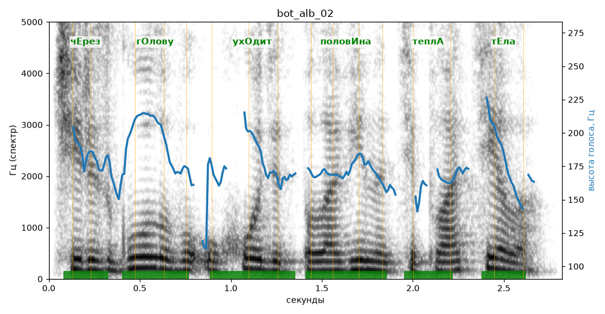

# bot_alb_02

Голос: **Альбина (бот «Почему так?», режим bot)** · длительность 2.8 с
Естественность (UTMOS): **3.67 из 5** (живой диктор ≈ 4–4.5)
Эталон: Через голову уходит половина тепла тела?
Распознано: через голову уходит половина теплотела.
Расхождения в словах: «тепла тела» → «теплотела»

## Ударения
(где нужно: ruaccent)

| слово | нужно | у голоса | |
|---|---|---|---|
| через | чЕрез | чЕрез | ✓ |
| голову | гОлову | гОлову | ✓ |
| уходит | ухОдит | ухОдит | ✓ |
| половина | половИна | половИна | ✓ |
| тепла | теплА | теплА | ✓ |
| тела | тЕла | тЕла | ✓ |

## Интонация
- ✗ «через голову уходит половина тепла тела?» — нет вопросительного подъёма (самое высокое место — «голову», в начале) — звучит как утверждение
- Диапазон голоса 5.7 полутонов (нормально), средняя высота 171 Гц

## Паузы и темп
- паузы на своих местах
- Темп 6.7 слога/с (быстро)

_Синяя линия — высота голоса. Над словами заглавная буква — где ударение должно быть; красным — голос поставил не туда (уверенно), оранжевым — возможно._
