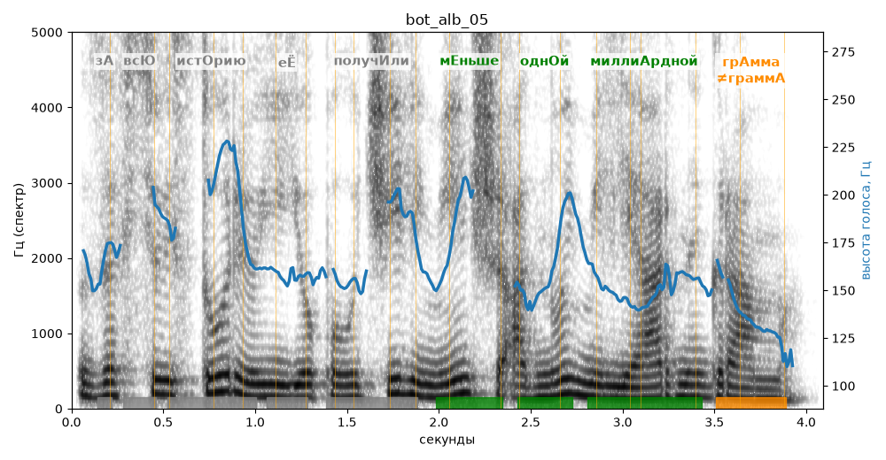

# bot_alb_05

Голос: **Альбина (бот «Почему так?», режим bot)** · длительность 4.1 с
Естественность (UTMOS): **3.16 из 5** (живой диктор ≈ 4–4.5)
Эталон: За всю историю её получили меньше одной миллиардной грамма.
Распознано: За всю историю ее получили меньше одной миллиарды грамма.
Расхождения в словах: «миллиардной» → «миллиарды»

## Ударения
(где нужно: ruaccent)

| слово | нужно | у голоса | |
|---|---|---|---|
| историю | истОрию | — | ? |
| её | еЁ | Её | ? не разобрать |
| получили | получИли | пОлучили | ? не разобрать |
| меньше | мЕньше | мЕньше | ✓ |
| одной | однОй | однОй | ✓ |
| миллиардной | миллиАрдной | миллиАрдной | ✓ |
| грамма | грАмма | граммА | ✗? возможно — послушать |

## Интонация
- ✓ «за всю историю её получили меньше одной миллиардной грамма.» — конец фразы понижается — звучит законченно
- Диапазон голоса 8.2 полутонов (живо), средняя высота 157 Гц

## Паузы и темп
- паузы на своих местах
- Темп 5.6 слога/с (нормально)

_Синяя линия — высота голоса. Над словами заглавная буква — где ударение должно быть; красным — голос поставил не туда (уверенно), оранжевым — возможно._
