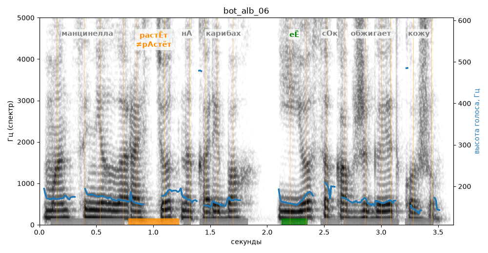

# bot_alb_06

Голос: **Альбина (бот «Почему так?», режим bot)** · длительность 3.6 с
Естественность (UTMOS): **3.48 из 5** (живой диктор ≈ 4–4.5)
Эталон: Манцинелла растёт на Карибах, её сок обжигает кожу.
Распознано: Мансы не лорастет на коребах, ее сок обжигает кожу.
Расхождения в словах: «манцинелла растет» → «мансы не лорастет»; «карибах» → «коребах»

## Ударения
(где нужно: нет)

| слово | нужно | у голоса | |
|---|---|---|---|
| манцинелла | манцинелла | мАнцинелла | нет эталона |
| растёт | растЁт | рАстёт | ✗? возможно — послушать |
| карибах | карибах | кАрибах | нет эталона |
| её | еЁ | еЁ | ✓ |
| обжигает | обжигает | обжигаЕт | нет эталона |
| кожу | кожу | кОжу | нет эталона |

## Интонация
- ✓ «манцинелла растёт на карибах её сок обжигает кожу.» — конец фразы понижается — звучит законченно
- Диапазон голоса 4.4 полутонов (монотонно, как робот), средняя высота 167 Гц

## Паузы и темп
- паузы на своих местах
- Темп 6.2 слога/с (нормально)

_Синяя линия — высота голоса. Над словами заглавная буква — где ударение должно быть; красным — голос поставил не туда (уверенно), оранжевым — возможно._
