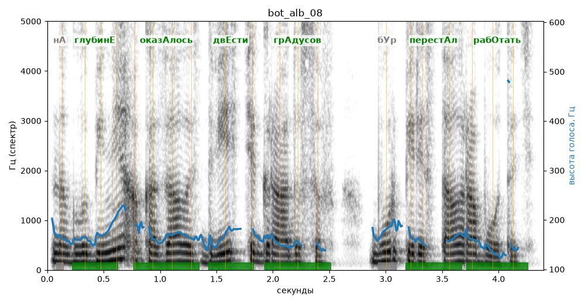

# bot_alb_08

Голос: **Альбина (бот «Почему так?», режим bot)** · длительность 4.4 с
Естественность (UTMOS): **3.18 из 5** (живой диктор ≈ 4–4.5)
Эталон: На глубине оказалось двести градусов, бур перестал работать.
Распознано: На глубине оказалось 200 градусов. Бур перестал работать.
Расхождения в словах: «двести» → «200»

## Ударения
(где нужно: ruaccent)

| слово | нужно | у голоса | |
|---|---|---|---|
| глубине | глубинЕ | глубинЕ | ✓ |
| оказалось | оказАлось | оказАлось | ✓ |
| двести | двЕсти | двЕсти | ✓ |
| градусов | грАдусов | грАдусов | ✓ |
| перестал | перестАл | перестАл | ✓ |
| работать | рабОтать | рабОтать | ✓ |

## Интонация
- ✓ «на глубине оказалось двести градусов бур перестал работать.» — конец фразы понижается — звучит законченно
- Диапазон голоса 6.3 полутонов (нормально), средняя высота 163 Гц

## Паузы и темп
- паузы на своих местах
- Темп 5.3 слога/с (нормально)

_Синяя линия — высота голоса. Над словами заглавная буква — где ударение должно быть; красным — голос поставил не туда (уверенно), оранжевым — возможно._
