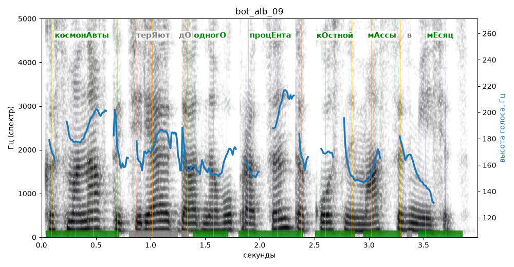

# bot_alb_09

Голос: **Альбина (бот «Почему так?», режим bot)** · длительность 4.0 с
Естественность (UTMOS): **3.45 из 5** (живой диктор ≈ 4–4.5)
Эталон: Космонавты теряют до одного процента костной массы в месяц.
Распознано: Космонавты теряют до 1% костной массы в месяц.
Расхождения в словах: «одного процента» → «1»

## Ударения
(где нужно: ruaccent)

| слово | нужно | у голоса | |
|---|---|---|---|
| космонавты | космонАвты | космонАвты | ✓ |
| теряют | терЯют | — | ? |
| одного | одногО | одногО | ✓ |
| процента | процЕнта | процЕнта | ✓ |
| костной | кОстной | кОстной | ✓ |
| массы | мАссы | мАссы | ✓ |
| месяц | мЕсяц | мЕсяц | ✓ |

## Интонация
- ✓ «космонавты теряют до одного процента костной массы в месяц.» — конец фразы понижается — звучит законченно
- Диапазон голоса 5.6 полутонов (нормально), средняя высота 168 Гц

## Паузы и темп
- паузы на своих местах
- Темп 5.2 слога/с (нормально)

_Синяя линия — высота голоса. Над словами заглавная буква — где ударение должно быть; красным — голос поставил не туда (уверенно), оранжевым — возможно._
