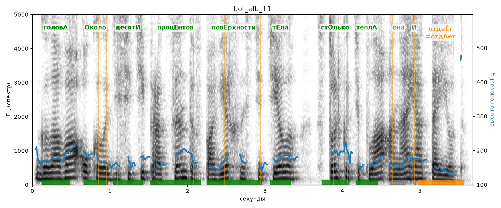

# bot_alb_11

Голос: **Альбина (бот «Почему так?», режим bot)** · длительность 5.7 с
Естественность (UTMOS): **2.53 из 5** (живой диктор ≈ 4–4.5)
Эталон: Голова — около десяти процентов поверхности тела, столько тепла она и отдаёт.
Распознано: голова около 10% поверхности тела столько тепла она и отдаёт.
Расхождения в словах: «десяти процентов» → «10»

## Ударения
(где нужно: ruaccent)

| слово | нужно | у голоса | |
|---|---|---|---|
| голова | головА | головА | ✓ |
| около | Около | Около | ✓ |
| десяти | десятИ | десятИ | ✓ |
| процентов | процЕнтов | процЕнтов | ✓ |
| поверхности | повЕрхности | повЕрхности | ✓ |
| тела | тЕла | тЕла | ✓ |
| столько | стОлько | стОлько | ✓ |
| тепла | теплА | теплА | ✓ |
| она | она | онА | нет эталона |
| отдаёт | отдаЁт | отдАёт | ✗? возможно — послушать |

## Интонация
- ✓ «голова около десяти процентов поверхности тела столько тепла она и отдаёт.» — конец фразы понижается — звучит законченно
- Диапазон голоса 6.1 полутонов (нормально), средняя высота 172 Гц

## Паузы и темп
- паузы на своих местах
- Темп 6.0 слога/с (нормально)

_Синяя линия — высота голоса. Над словами заглавная буква — где ударение должно быть; красным — голос поставил не туда (уверенно), оранжевым — возможно._
