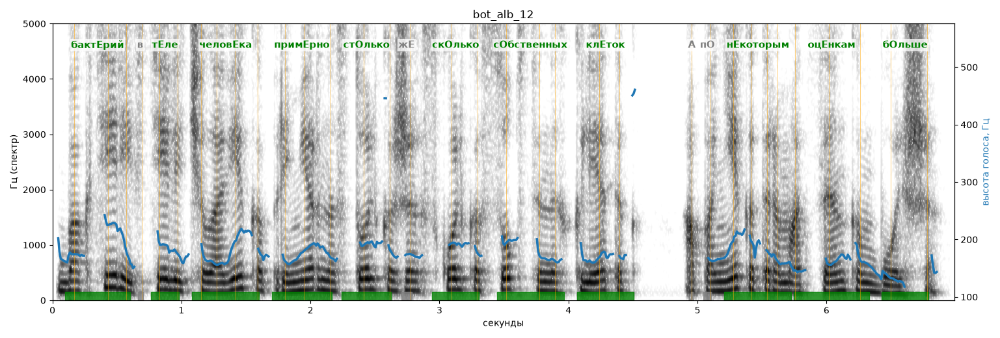

# bot_alb_12

Голос: **Альбина (бот «Почему так?», режим bot)** · длительность 7.0 с
Естественность (UTMOS): **3.19 из 5** (живой диктор ≈ 4–4.5)
Эталон: Бактерий в теле человека примерно столько же, сколько собственных клеток, а по некоторым оценкам — больше.
Распознано: Бактерий в теле человека примерно столько же, сколько собственных клеток, а по некоторым оценкам больше.
Слова: все совпали

## Ударения
(где нужно: ruaccent)

| слово | нужно | у голоса | |
|---|---|---|---|
| бактерий | бактЕрий | бактЕрий | ✓ |
| теле | тЕле | тЕле | ✓ |
| человека | человЕка | человЕка | ✓ |
| примерно | примЕрно | примЕрно | ✓ |
| столько | стОлько | стОлько | ✓ |
| сколько | скОлько | скОлько | ✓ |
| собственных | сОбственных | сОбственных | ✓ |
| клеток | клЕток | клЕток | ✓ |
| некоторым | нЕкоторым | нЕкоторым | ✓ |
| оценкам | оцЕнкам | оцЕнкам | ✓ |
| больше | бОльше | бОльше | ✓ |

## Интонация
- ✓ «бактерий в теле человека примерно столько же сколько собственных клеток а по некоторым оценкам больше.» — конец фразы понижается — звучит законченно
- Диапазон голоса 7.2 полутонов (живо), средняя высота 172 Гц

## Паузы и темп
- паузы на своих местах
- Темп 5.6 слога/с (нормально)

_Синяя линия — высота голоса. Над словами заглавная буква — где ударение должно быть; красным — голос поставил не туда (уверенно), оранжевым — возможно._
