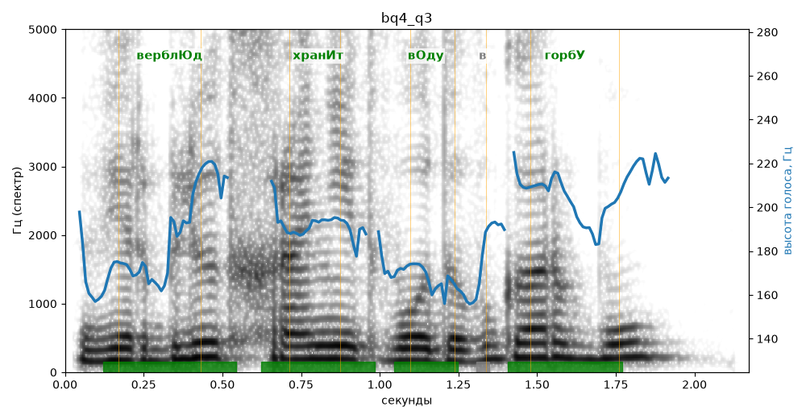

# bq4_q3

Голос: **silero_cis:ru_albina@ssml,soft** · длительность 2.2 с
Естественность (UTMOS): **2.64 из 5** (живой диктор ≈ 4–4.5)
Эталон: Верблюд хранит воду в горбу?
Распознано: Верблюд хранит воду в горбу.
Слова: все совпали

## Ударения
(где нужно: ruaccent)

| слово | нужно | у голоса | |
|---|---|---|---|
| верблюд | верблЮд | верблЮд | ✓ |
| хранит | хранИт | хранИт | ✓ |
| воду | вОду | вОду | ✓ |
| горбу | горбУ | горбУ | ✓ |

## Интонация
- ✗ «верблюд хранит воду в горбу?» — нет вопросительного подъёма (самое высокое место — «верблюд», в начале) — звучит как утверждение
- Диапазон голоса 5.5 полутонов (нормально), средняя высота 191 Гц

## Паузы и темп
- паузы на своих местах
- Темп 5.5 слога/с (нормально)

_Синяя линия — высота голоса. Над словами заглавная буква — где ударение должно быть; красным — голос поставил не туда (уверенно), оранжевым — возможно._
