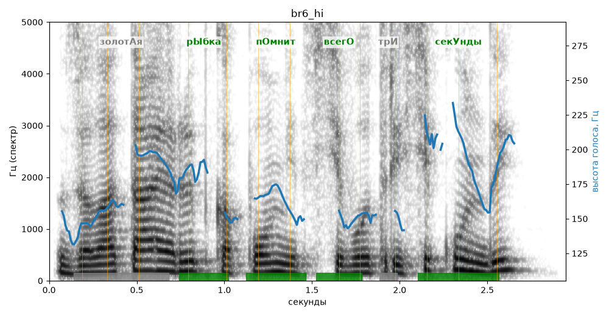

# br6_hi

Голос: **silero_cis:ru_albina@ssml,soft** · длительность 2.9 с
Естественность (UTMOS): **2.97 из 5** (живой диктор ≈ 4–4.5)
Эталон: Золотая рыбка помнит всего три секунды?
Распознано: Золотая рыбка помнит всего три секунды.
Слова: все совпали

## Ударения
(где нужно: ruaccent)

| слово | нужно | у голоса | |
|---|---|---|---|
| золотая | золотАя | — | ? |
| рыбка | рЫбка | рЫбка | ✓ |
| помнит | пОмнит | пОмнит | ✓ |
| всего | всегО | всегО | ✓ |
| секунды | секУнды | секУнды | ✓ |

## Интонация
- ✓ «золотая рыбка помнит всего три секунды?» — вопросительный подъём на слове «секунды»
- Диапазон голоса 6.7 полутонов (нормально), средняя высота 166 Гц

## Паузы и темп
- паузы на своих местах
- Темп 5.4 слога/с (нормально)

_Синяя линия — высота голоса. Над словами заглавная буква — где ударение должно быть; красным — голос поставил не туда (уверенно), оранжевым — возможно._
