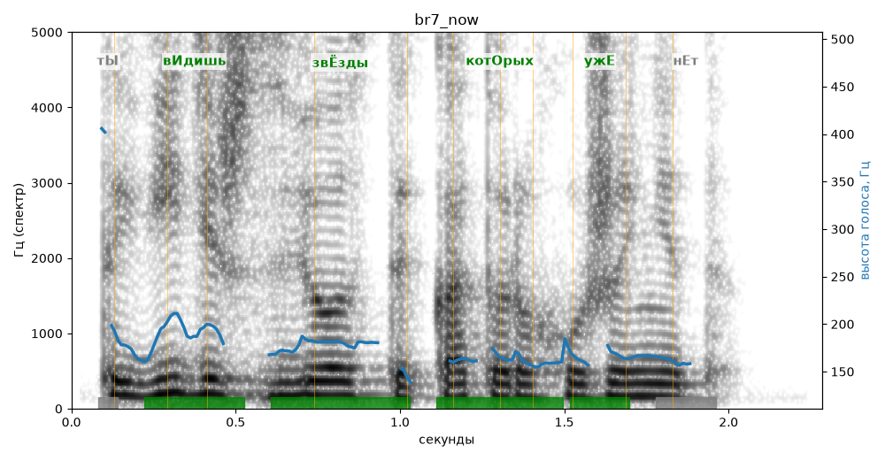

# br7_now

Голос: **silero_cis:ru_albina@ssml,soft** · длительность 2.3 с
Естественность (UTMOS): **2.98 из 5** (живой диктор ≈ 4–4.5)
Эталон: Ты видишь звёзды, которых уже нет?
Распознано: Ты видишь звезды, которых уже нет.
Слова: все совпали

## Ударения
(где нужно: ruaccent)

| слово | нужно | у голоса | |
|---|---|---|---|
| видишь | вИдишь | вИдишь | ✓ |
| звёзды | звЁзды | звЁзды | ✓ |
| которых | котОрых | котОрых | ✓ |
| уже | ужЕ | ужЕ | ✓ |

## Интонация
- ✗ «ты видишь звёзды которых уже нет?» — нет вопросительного подъёма (самое высокое место — «видишь», в начале) — звучит как утверждение
- Диапазон голоса 4.2 полутонов (монотонно, как робот), средняя высота 170 Гц

## Паузы и темп
- паузы на своих местах
- Темп 5.9 слога/с (нормально)

_Синяя линия — высота голоса. Над словами заглавная буква — где ударение должно быть; красным — голос поставил не туда (уверенно), оранжевым — возможно._
