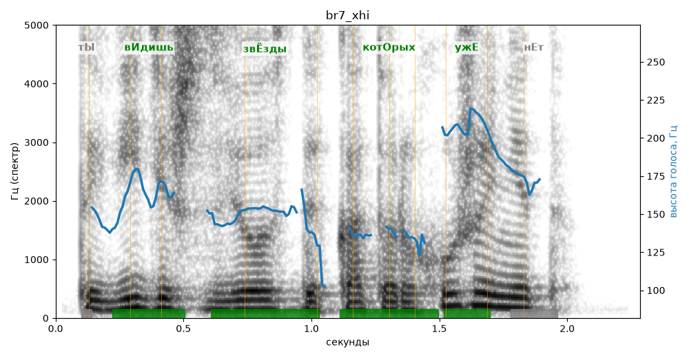

# br7_xhi

Голос: **silero_cis:ru_albina@ssml,soft** · длительность 2.3 с
Естественность (UTMOS): **2.95 из 5** (живой диктор ≈ 4–4.5)
Эталон: Ты видишь звёзды, которых уже нет?
Распознано: Ты видишь звёзды, которых уже нет?
Слова: все совпали

## Ударения
(где нужно: ruaccent)

| слово | нужно | у голоса | |
|---|---|---|---|
| видишь | вИдишь | вИдишь | ✓ |
| звёзды | звЁзды | звЁзды | ✓ |
| которых | котОрых | котОрых | ✓ |
| уже | ужЕ | ужЕ | ✓ |

## Интонация
- ✓ «ты видишь звёзды которых уже нет?» — вопросительный подъём на слове «уже»
- Диапазон голоса 7.6 полутонов (живо), средняя высота 154 Гц

## Паузы и темп
- паузы на своих местах
- Темп 5.9 слога/с (нормально)

_Синяя линия — высота голоса. Над словами заглавная буква — где ударение должно быть; красным — голос поставил не туда (уверенно), оранжевым — возможно._
