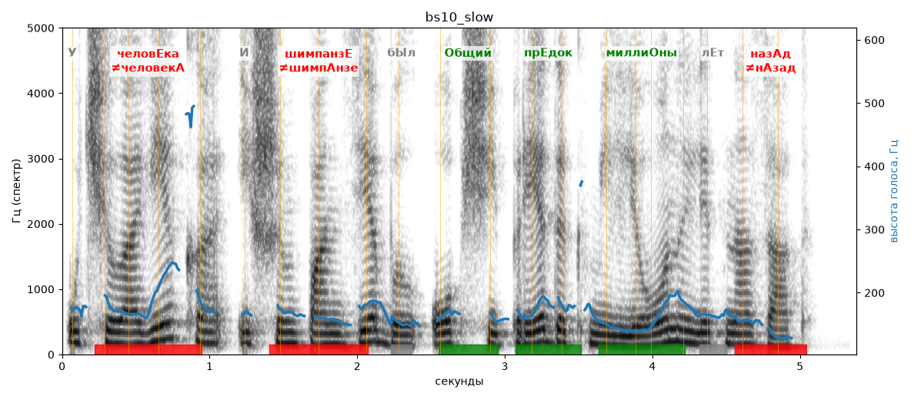

# bs10_slow

Голос: **silero_cis:ru_albina@ssml,soft** · длительность 5.4 с
Естественность (UTMOS): **3.32 из 5** (живой диктор ≈ 4–4.5)
Эталон: У человека и шимпанзе был общий предок миллионы лет назад.
Распознано: у человека и шимпанзе был общий предок миллионы лет назад.
Слова: все совпали

## Ударения
(где нужно: ruaccent)

| слово | нужно | у голоса | |
|---|---|---|---|
| человека | человЕка | человекА | ✗ ОШИБКА |
| шимпанзе | шимпанзЕ | шимпАнзе | ✗ ОШИБКА |
| общий | Общий | Общий | ✓ |
| предок | прЕдок | прЕдок | ✓ |
| миллионы | миллиОны | миллиОны | ✓ |
| назад | назАд | нАзад | ✗ ОШИБКА |

## Интонация
- ✓ «у человека и шимпанзе был общий предок миллионы лет назад.» — конец фразы понижается — звучит законченно
- Диапазон голоса 8.2 полутонов (живо), средняя высота 165 Гц

## Паузы и темп
- паузы на своих местах
- Темп 5.0 слога/с (нормально)

_Синяя линия — высота голоса. Над словами заглавная буква — где ударение должно быть; красным — голос поставил не туда (уверенно), оранжевым — возможно._
