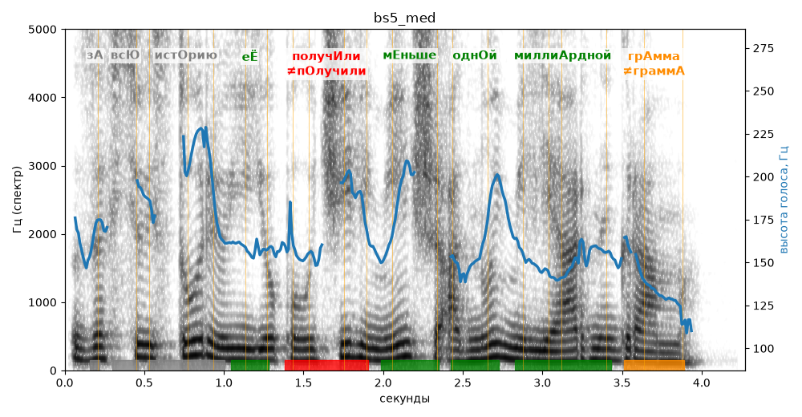

# bs5_med

Голос: **silero_cis:ru_albina@ssml,soft** · длительность 4.3 с
Естественность (UTMOS): **3.22 из 5** (живой диктор ≈ 4–4.5)
Эталон: За всю историю её получили меньше одной миллиардной грамма.
Распознано: За всю историю ее получили меньше одной миллиарды грамм.
Расхождения в словах: «миллиардной грамма» → «миллиарды грамм»

## Ударения
(где нужно: ruaccent)

| слово | нужно | у голоса | |
|---|---|---|---|
| историю | истОрию | — | ? |
| её | еЁ | еЁ | ✓ |
| получили | получИли | пОлучили | ✗ ОШИБКА |
| меньше | мЕньше | мЕньше | ✓ |
| одной | однОй | однОй | ✓ |
| миллиардной | миллиАрдной | миллиАрдной | ✓ |
| грамма | грАмма | граммА | ✗? возможно — послушать |

## Интонация
- ✓ «за всю историю её получили меньше одной миллиардной грамма.» — конец фразы понижается — звучит законченно
- Диапазон голоса 8.3 полутонов (живо), средняя высота 158 Гц

## Паузы и темп
- паузы на своих местах
- Темп 5.6 слога/с (нормально)

_Синяя линия — высота голоса. Над словами заглавная буква — где ударение должно быть; красным — голос поставил не туда (уверенно), оранжевым — возможно._
