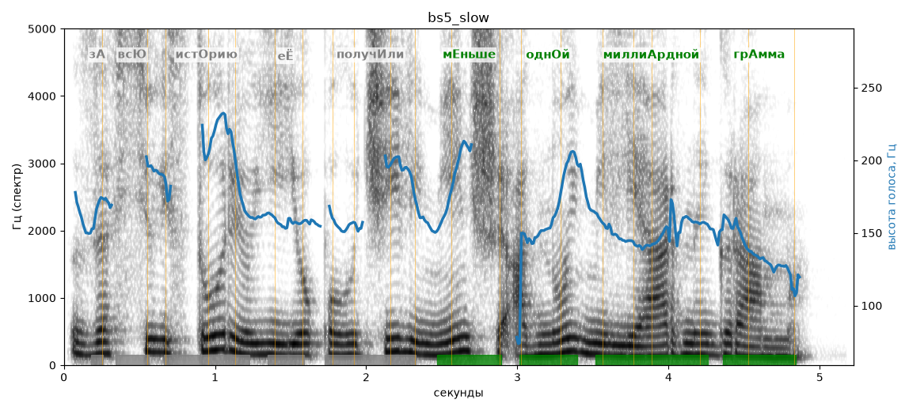

# bs5_slow

Голос: **silero_cis:ru_albina@ssml,soft** · длительность 5.2 с
Естественность (UTMOS): **2.9 из 5** (живой диктор ≈ 4–4.5)
Эталон: За всю историю её получили меньше одной миллиардной грамма.
Распознано: за всю историю ее получили меньше одной миллиардной грамма.
Слова: все совпали

## Ударения
(где нужно: ruaccent)

| слово | нужно | у голоса | |
|---|---|---|---|
| историю | истОрию | — | ? |
| её | еЁ | Её | ? не разобрать |
| получили | получИли | получилИ | ? не разобрать |
| меньше | мЕньше | мЕньше | ✓ |
| одной | однОй | однОй | ✓ |
| миллиардной | миллиАрдной | миллиАрдной | ✓ |
| грамма | грАмма | грАмма | ✓ |

## Интонация
- ✓ «за всю историю её получили меньше одной миллиардной грамма.» — конец фразы понижается — звучит законченно
- Диапазон голоса 8.7 полутонов (живо), средняя высота 157 Гц

## Паузы и темп
- паузы на своих местах
- Темп 4.5 слога/с (нормально)

_Синяя линия — высота голоса. Над словами заглавная буква — где ударение должно быть; красным — голос поставил не туда (уверенно), оранжевым — возможно._
