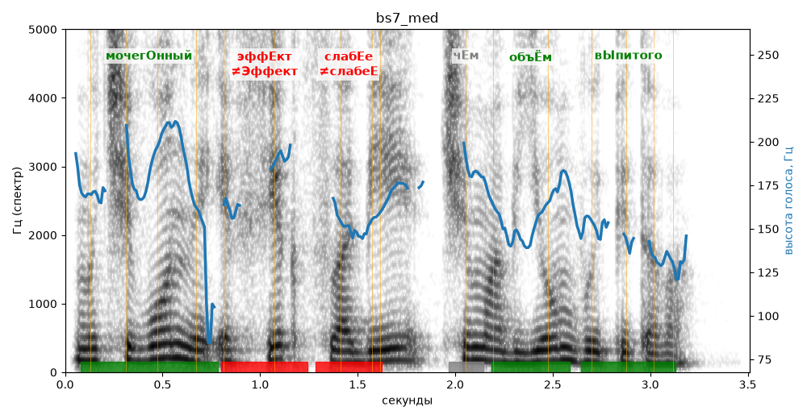

# bs7_med

Голос: **silero_cis:ru_albina@ssml,soft** · длительность 3.5 с
Естественность (UTMOS): **3.54 из 5** (живой диктор ≈ 4–4.5)
Эталон: Мочегонный эффект слабее, чем объём выпитого.
Распознано: мычевонный эффект слабее, чем объем выпятого.
Расхождения в словах: «мочегонный» → «мычевонный»; «выпитого» → «выпятого»

## Ударения
(где нужно: ruaccent)

| слово | нужно | у голоса | |
|---|---|---|---|
| мочегонный | мочегОнный | мочегОнный | ✓ |
| эффект | эффЕкт | Эффект | ✗ ОШИБКА |
| слабее | слабЕе | слабеЕ | ✗ ОШИБКА |
| объём | объЁм | объЁм | ✓ |
| выпитого | вЫпитого | вЫпитого | ✓ |

## Интонация
- ✓ «мочегонный эффект слабее чем объём выпитого.» — конец фразы понижается — звучит законченно
- Диапазон голоса 7.6 полутонов (живо), средняя высота 164 Гц

## Паузы и темп
- паузы на своих местах
- Темп 5.9 слога/с (нормально)

_Синяя линия — высота голоса. Над словами заглавная буква — где ударение должно быть; красным — голос поставил не туда (уверенно), оранжевым — возможно._
