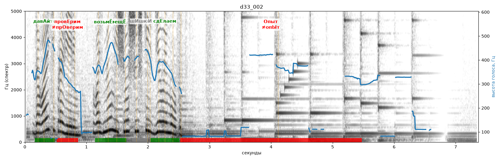

# d33_002

Голос: **Серия 33d, Пик, голос iPhone с переносом** · длительность 7.4 с
Естественность (UTMOS): **1.27 из 5** (живой диктор ≈ 4–4.5)
Эталон: Давайте проверим. Возьмём ещё шишки и сделаем опыт.
Распознано: Давайте проверим. Возьмём ещё шишки и сделаем опыт.
Слова: все совпали

## Ударения
(где нужно: ruaccent)

| слово | нужно | у голоса | |
|---|---|---|---|
| давайте | давАйте | давАйте | ✓ |
| проверим | провЕрим | прОверим | ✗ ОШИБКА |
| возьмём | возьмЁм | возьмЁм | ✓ |
| ещё | ещЁ | ещЁ | ✓ |
| шишки | шИшки | шишкИ | ? не разобрать |
| сделаем | сдЕлаем | сдЕлаем | ✓ |
| опыт | Опыт | опЫт | ✗ ОШИБКА |

## Интонация
- ✓ «давайте проверим.» — конец фразы понижается — звучит законченно
- ✓ «возьмём ещё шишки и сделаем опыт.» — конец фразы понижается — звучит законченно
- Диапазон голоса 28.8 полутонов (живо), средняя высота 327 Гц

## Паузы и темп
- паузы на своих местах
- Темп 3.6 слога/с (медленно)

_Синяя линия — высота голоса. Над словами заглавная буква — где ударение должно быть; красным — голос поставил не туда (уверенно), оранжевым — возможно._
