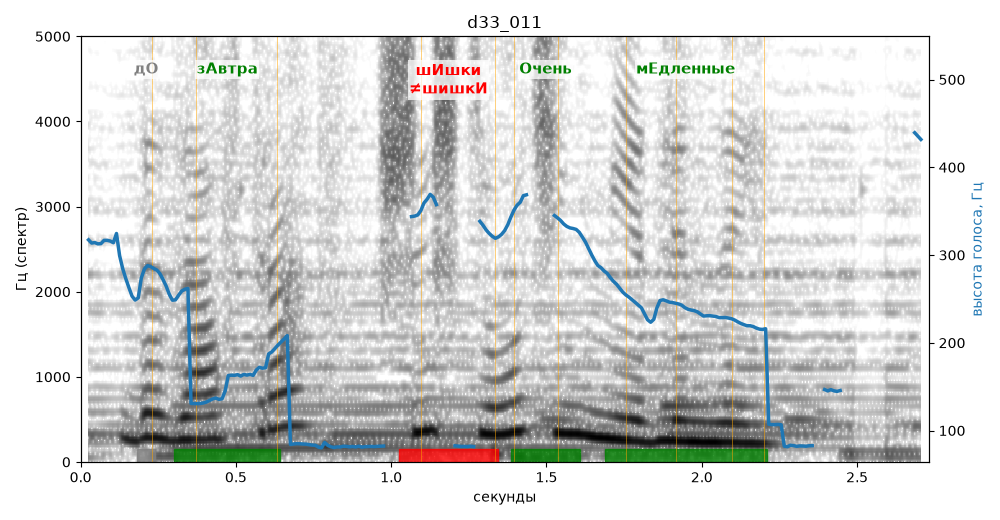

# d33_011

Голос: **Серия 33d, Рон, голос iPhone с переносом** · длительность 2.7 с
Естественность (UTMOS): **1.38 из 5** (живой диктор ≈ 4–4.5)
Эталон: До завтра? Шишки очень медленные.
Распознано: До завтра шишки очень медленные.
Слова: все совпали

## Ударения
(где нужно: ruaccent)

| слово | нужно | у голоса | |
|---|---|---|---|
| завтра | зАвтра | зАвтра | ✓ |
| шишки | шИшки | шишкИ | ✗ ОШИБКА |
| очень | Очень | Очень | ✓ |
| медленные | мЕдленные | мЕдленные | ✓ |

## Интонация
- ✓ «до завтра?» — вопросительный подъём на слове «до»
- ✓ «шишки очень медленные.» — конец фразы понижается — звучит законченно
- Диапазон голоса 25.5 полутонов (живо), средняя высота 230 Гц

## Паузы и темп
- паузы на своих местах
- Темп 6.7 слога/с (быстро)

_Синяя линия — высота голоса. Над словами заглавная буква — где ударение должно быть; красным — голос поставил не туда (уверенно), оранжевым — возможно._
