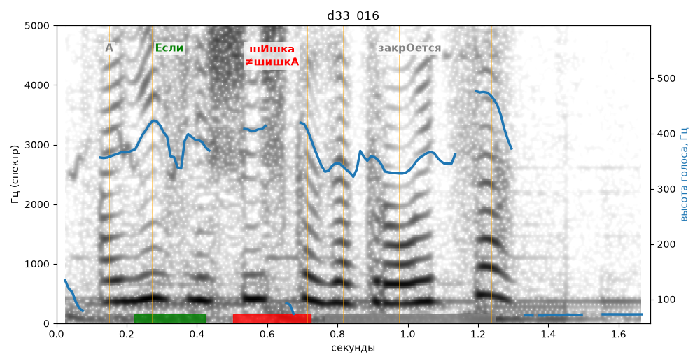

# d33_016

Голос: **Серия 33d, Пик, голос iPhone с переносом** · длительность 1.7 с
Естественность (UTMOS): **1.37 из 5** (живой диктор ≈ 4–4.5)
Эталон: А если шишка закроется?
Распознано: А не флешишка закроется?
Расхождения в словах: «если шишка» → «не флешишка»

## Ударения
(где нужно: ruaccent)

| слово | нужно | у голоса | |
|---|---|---|---|
| если | Если | Если | ✓ |
| шишка | шИшка | шишкА | ✗ ОШИБКА |
| закроется | закрОется | закроетсЯ | ? не разобрать |

## Интонация
- ✗ «а если шишка закроется?» — нет вопросительного подъёма (самое высокое место — «шишка», в начале) — звучит как утверждение
- Диапазон голоса 31.6 полутонов (живо), средняя высота 351 Гц

## Паузы и темп
- паузы на своих местах
- Темп 8.1 слога/с (быстро)

_Синяя линия — высота голоса. Над словами заглавная буква — где ударение должно быть; красным — голос поставил не туда (уверенно), оранжевым — возможно._
