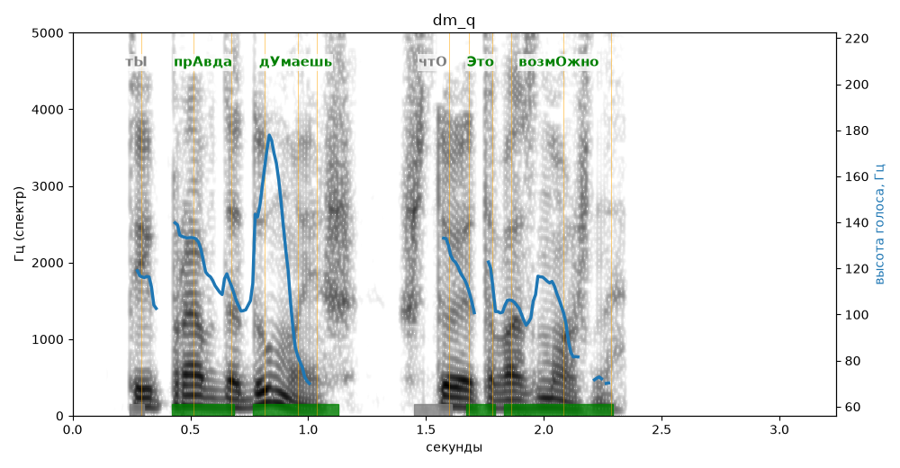

# dm_q

Голос: **edge:ru-RU-DmitryNeural** · длительность 3.2 с
Естественность (UTMOS): **3.79 из 5** (живой диктор ≈ 4–4.5)
Эталон: Ты правда думаешь, что это возможно?
Распознано: Ты правда думаешь, что это возможно?
Слова: все совпали

## Ударения
(где нужно: ruaccent)

| слово | нужно | у голоса | |
|---|---|---|---|
| правда | прАвда | прАвда | ✓ |
| думаешь | дУмаешь | дУмаешь | ✓ |
| это | Это | Это | ✓ |
| возможно | возмОжно | возмОжно | ✓ |

## Интонация
- ✓ «ты правда думаешь что это возможно?» — вопросительный подъём на слове «думаешь»
- Диапазон голоса 13.5 полутонов (живо), средняя высота 112 Гц

## Паузы и темп
- паузы на своих местах
- Темп 8.4 слога/с (быстро)

_Синяя линия — высота голоса. Над словами заглавная буква — где ударение должно быть; красным — голос поставил не туда (уверенно), оранжевым — возможно._
