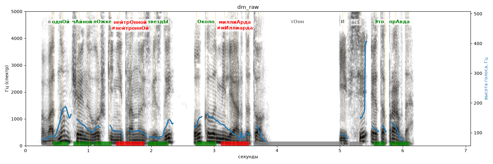

# dm_raw

Голос: **edge:ru-RU-DmitryNeural** · длительность 7.1 с
Естественность (UTMOS): **3.71 из 5** (живой диктор ≈ 4–4.5)
Эталон: В одной чайной ложке нейтронной звезды — около миллиарда тонн. И всё это правда!
Распознано: В одном чайной ложке нейтральной звезды около миллиарда тонн. И все это правда.
Расхождения в словах: «одной» → «одном»; «нейтронной» → «нейтральной»

## Ударения
(где нужно: ruaccent)

| слово | нужно | у голоса | |
|---|---|---|---|
| одной | однОй | однОй | ✓ |
| чайной | чАйной | чАйной | ✓ |
| ложке | лОжке | лОжке | ✓ |
| нейтронной | нейтрОнной | нейтроннОй | ✗ ОШИБКА |
| звезды | звездЫ | звездЫ | ✓ |
| около | Около | Около | ✓ |
| миллиарда | миллиАрда | мИллиарда | ✗ ОШИБКА |
| это | Это | Это | ✓ |
| правда | прАвда | прАвда | ✓ |

## Интонация
- ✓ «в одной чайной ложке нейтронной звезды около миллиарда тонн.» — конец фразы понижается — звучит законченно
- ✓ «и всё это правда!» — выделено слово «всё» (+6.9 пт)
- Диапазон голоса 12.4 полутонов (живо), средняя высота 107 Гц

## Паузы и темп
- после «тонн.» пауза всего 0.02 с — фразы слипаются
- Темп 5.8 слога/с (нормально)

_Синяя линия — высота голоса. Над словами: заглавная буква — где ударение должно быть; красным — где голос его поставил не туда._
