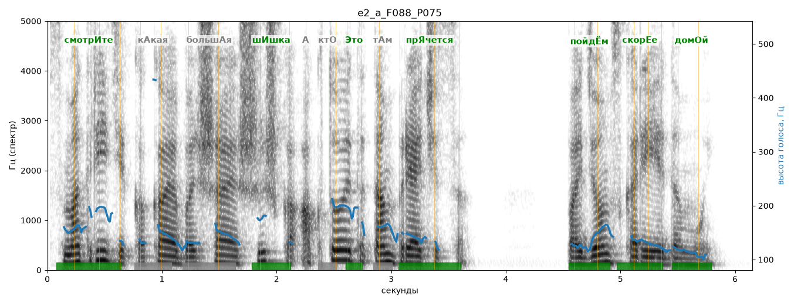

# e2_a_F088_P075

Голос: **a_F088_P075** · длительность 6.2 с
Естественность (UTMOS): **3.35 из 5** (живой диктор ≈ 4–4.5)
Эталон: Смотрите, какая большая шишка! А кто это там прячется? Пойдём скорее домой.
Распознано: Смотрите, какая большая шишка, а кто это там прячется? Пойдем скорее домой.
Слова: все совпали

## Ударения
(где нужно: ruaccent)

| слово | нужно | у голоса | |
|---|---|---|---|
| смотрите | смотрИте | смотрИте | ✓ |
| какая | кАкая | — | ? |
| большая | большАя | — | ? |
| шишка | шИшка | шИшка | ✓ |
| это | Это | Это | ✓ |
| прячется | прЯчется | прЯчется | ✓ |
| пойдём | пойдЁм | пойдЁм | ✓ |
| скорее | скорЕе | скорЕе | ✓ |
| домой | домОй | домОй | ✓ |

## Интонация
- ✓ «смотрите какая большая шишка!» — выделено слово «смотрите» (+4.7 пт)
- ✗ «а кто это там прячется?» — нет вопросительного подъёма (самое высокое место — «кто», в начале) — звучит как утверждение
- ✓ «пойдём скорее домой.» — конец фразы понижается — звучит законченно
- Диапазон голоса 9.6 полутонов (живо), средняя высота 142 Гц

## Паузы и темп
- после «шишка!» пауза всего 0.12 с — фразы слипаются
- Темп 5.0 слога/с (нормально)

_Синяя линия — высота голоса. Над словами заглавная буква — где ударение должно быть; красным — голос поставил не туда (уверенно), оранжевым — возможно._
