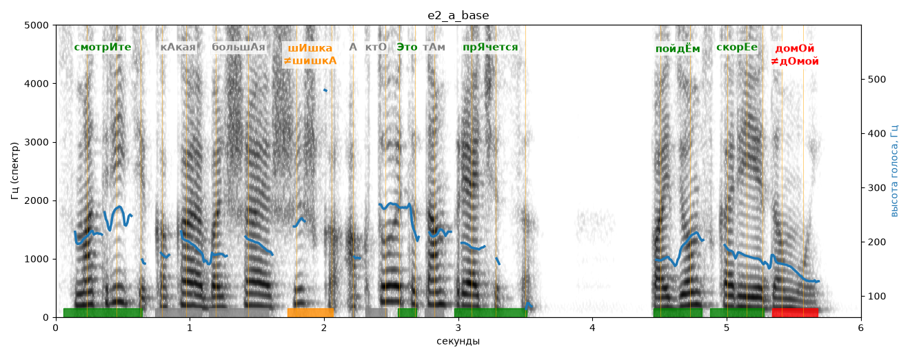

# e2_a_base

Голос: **a_base** · длительность 6.0 с
Естественность (UTMOS): **3.54 из 5** (живой диктор ≈ 4–4.5)
Эталон: Смотрите, какая большая шишка! А кто это там прячется? Пойдём скорее домой.
Распознано: Смотрите, какая большая шишка, а кто это там прячется? Пойдем скорее домой.
Слова: все совпали

## Ударения
(где нужно: ruaccent)

| слово | нужно | у голоса | |
|---|---|---|---|
| смотрите | смотрИте | смотрИте | ✓ |
| какая | кАкая | — | ? |
| большая | большАя | — | ? |
| шишка | шИшка | шишкА | ✗? возможно — послушать |
| это | Это | Это | ✓ |
| прячется | прЯчется | прЯчется | ✓ |
| пойдём | пойдЁм | пойдЁм | ✓ |
| скорее | скорЕе | скорЕе | ✓ |
| домой | домОй | дОмой | ✗ ОШИБКА |

## Интонация
- ✓ «смотрите какая большая шишка!» — выделено слово «смотрите» (+3.6 пт)
- ✓ «а кто это там прячется?» — вопросительный подъём на слове «кто»
- ✓ «пойдём скорее домой.» — конец фразы понижается — звучит законченно
- Диапазон голоса 12.3 полутонов (живо), средняя высота 190 Гц

## Паузы и темп
- после «шишка!» пауза всего 0.14 с — фразы слипаются
- Темп 5.1 слога/с (нормально)

_Синяя линия — высота голоса. Над словами заглавная буква — где ударение должно быть; красным — голос поставил не туда (уверенно), оранжевым — возможно._
