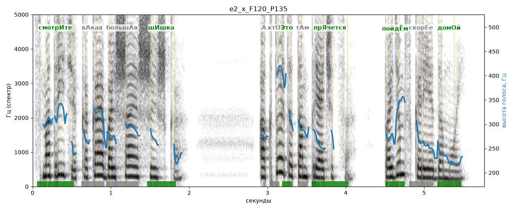

# e2_x_F120_P135

Голос: **x_F120_P135** · длительность 5.8 с
Естественность (UTMOS): **3.51 из 5** (живой диктор ≈ 4–4.5)
Эталон: Смотрите, какая большая шишка! А кто это там прячется? Пойдём скорее домой.
Распознано: Смотрите, какая большая шишка. А кто это там прячется? Пойдем скорее домой.
Слова: все совпали

## Ударения
(где нужно: ruaccent)

| слово | нужно | у голоса | |
|---|---|---|---|
| смотрите | смотрИте | смотрИте | ✓ |
| какая | кАкая | — | ? |
| большая | большАя | — | ? |
| шишка | шИшка | шИшка | ✓ |
| это | Это | Это | ✓ |
| прячется | прЯчется | прЯчется | ✓ |
| пойдём | пойдЁм | пойдЁм | ✓ |
| скорее | скорЕе | скореЕ | ? не разобрать |
| домой | домОй | домОй | ✓ |

## Интонация
- ✓ «смотрите какая большая шишка!» — выделено слово «смотрите» (+3.2 пт)
- ✓ «а кто это там прячется?» — вопросительный подъём на слове «кто»
- ✓ «пойдём скорее домой.» — конец фразы понижается — звучит законченно
- Диапазон голоса 8.3 полутонов (живо), средняя высота 276 Гц

## Паузы и темп
- паузы на своих местах
- Темп 6.3 слога/с (нормально)

_Синяя линия — высота голоса. Над словами заглавная буква — где ударение должно быть; красным — голос поставил не туда (уверенно), оранжевым — возможно._
