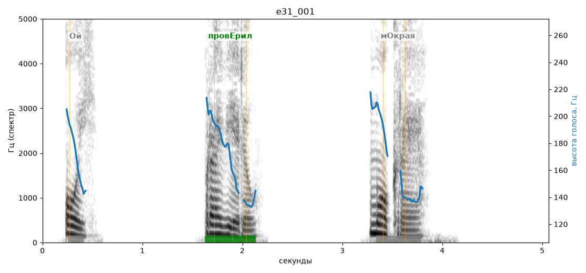

# e31_001

Голос: **edge:ru-RU-SvetlanaNeural** · длительность 5.1 с
Естественность (UTMOS): **3.57 из 5** (живой диктор ≈ 4–4.5)
Эталон: Ой. Проверил. Мокрая.
Распознано: Ой! Проверил. Мокрая.
Слова: все совпали

## Ударения
(где нужно: ruaccent)

| слово | нужно | у голоса | |
|---|---|---|---|
| проверил | провЕрил | провЕрил | ✓ |
| мокрая | мОкрая | — | ? |

## Интонация
- ✗ «проверил.» — конец фразы не понижается — звучит незаконченно / как перечисление
- Диапазон голоса 7.5 полутонов (живо), средняя высота 168 Гц

## Паузы и темп
- паузы на своих местах
- Темп 5.5 слога/с (нормально)

_Синяя линия — высота голоса. Над словами заглавная буква — где ударение должно быть; красным — голос поставил не туда (уверенно), оранжевым — возможно._
