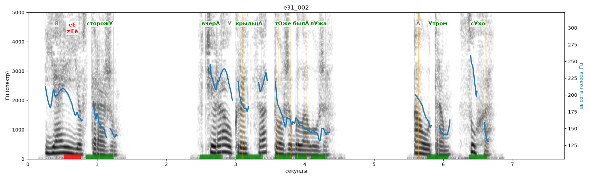

# e31_002

Голос: **edge:ru-RU-SvetlanaNeural** · длительность 7.8 с
Естественность (UTMOS): **3.7 из 5** (живой диктор ≈ 4–4.5)
Эталон: Я её сторожу. Вчера у крыльца тоже была лужа. А утром — сухо!
Распознано: Я её сторожу. Вчера у крыльца тоже была лужа. А утром – сухо.
Слова: все совпали

## Ударения
(где нужно: ruaccent)

| слово | нужно | у голоса | |
|---|---|---|---|
| её | еЁ | Её | ✗ ОШИБКА |
| сторожу | сторожУ | сторожУ | ✓ |
| вчера | вчерА | вчерА | ✓ |
| крыльца | крыльцА | крыльцА | ✓ |
| тоже | тОже | тОже | ✓ |
| была | былА | былА | ✓ |
| лужа | лУжа | лУжа | ✓ |
| утром | Утром | Утром | ✓ |
| сухо | сУхо | сУхо | ✓ |

## Интонация
- ✓ «я её сторожу.» — конец фразы понижается — звучит законченно
- ✓ «вчера у крыльца тоже была лужа.» — конец фразы понижается — звучит законченно
- ✓ «а утром сухо!» — выделено слово «сухо» (+6.0 пт)
- Диапазон голоса 8.8 полутонов (живо), средняя высота 173 Гц

## Паузы и темп
- паузы на своих местах
- Темп 6.6 слога/с (быстро)

_Синяя линия — высота голоса. Над словами заглавная буква — где ударение должно быть; красным — голос поставил не туда (уверенно), оранжевым — возможно._
