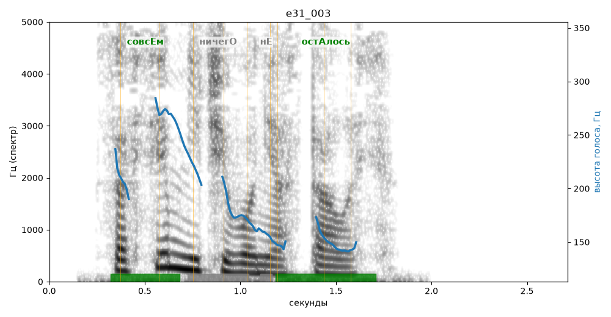

# e31_003

Голос: **edge:ru-RU-SvetlanaNeural** · длительность 2.7 с
Естественность (UTMOS): **4.18 из 5** (живой диктор ≈ 4–4.5)
Эталон: Совсем ничего не осталось?
Распознано: Совсем ничего не осталось.
Слова: все совпали

## Ударения
(где нужно: ruaccent)

| слово | нужно | у голоса | |
|---|---|---|---|
| совсем | совсЕм | совсЕм | ✓ |
| ничего | ничегО | нИчего | ? не разобрать |
| осталось | остАлось | остАлось | ✓ |

## Интонация
- ✗ «совсем ничего не осталось?» — нет вопросительного подъёма (самое высокое место — «совсем», в начале) — звучит как утверждение
- Диапазон голоса 11.2 полутонов (живо), средняя высота 173 Гц

## Паузы и темп
- паузы на своих местах
- Темп 6.5 слога/с (нормально)

_Синяя линия — высота голоса. Над словами заглавная буква — где ударение должно быть; красным — голос поставил не туда (уверенно), оранжевым — возможно._
