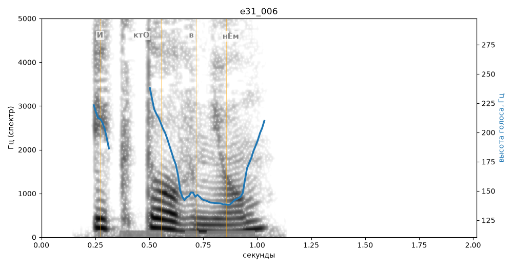

# e31_006

Голос: **edge:ru-RU-SvetlanaNeural** · длительность 2.0 с
Естественность (UTMOS): **3.78 из 5** (живой диктор ≈ 4–4.5)
Эталон: И кто в нём?
Распознано: И кто в нём?
Слова: все совпали

## Ударения
(где нужно: дано в тексте)

| слово | нужно | у голоса | |
|---|---|---|---|

## Интонация
- ✗ «и кто в нём?» — нет вопросительного подъёма (самое высокое место — «и», в начале) — звучит как утверждение
- Диапазон голоса 8.0 полутонов (живо), средняя высота 161 Гц

## Паузы и темп
- паузы на своих местах
- Темп 5.5 слога/с (нормально)

_Синяя линия — высота голоса. Над словами заглавная буква — где ударение должно быть; красным — голос поставил не туда (уверенно), оранжевым — возможно._
