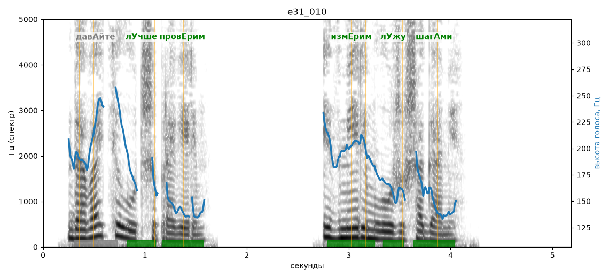

# e31_010

Голос: **edge:ru-RU-SvetlanaNeural** · длительность 5.2 с
Естественность (UTMOS): **3.86 из 5** (живой диктор ≈ 4–4.5)
Эталон: Давайте лучше проверим. Измерим лужу шагами.
Распознано: Давайте лучше проверим. Измерим лужу шагами.
Слова: все совпали

## Ударения
(где нужно: ruaccent)

| слово | нужно | у голоса | |
|---|---|---|---|
| давайте | давАйте | давайтЕ | ? не разобрать |
| лучше | лУчше | лУчше | ✓ |
| проверим | провЕрим | провЕрим | ✓ |
| измерим | измЕрим | измЕрим | ✓ |
| лужу | лУжу | лУжу | ✓ |
| шагами | шагАми | шагАми | ✓ |

## Интонация
- ✓ «давайте лучше проверим.» — конец фразы понижается — звучит законченно
- ✓ «измерим лужу шагами.» — конец фразы понижается — звучит законченно
- Диапазон голоса 9.5 полутонов (живо), средняя высота 175 Гц

## Паузы и темп
- паузы на своих местах
- Темп 6.4 слога/с (нормально)

_Синяя линия — высота голоса. Над словами заглавная буква — где ударение должно быть; красным — голос поставил не туда (уверенно), оранжевым — возможно._
