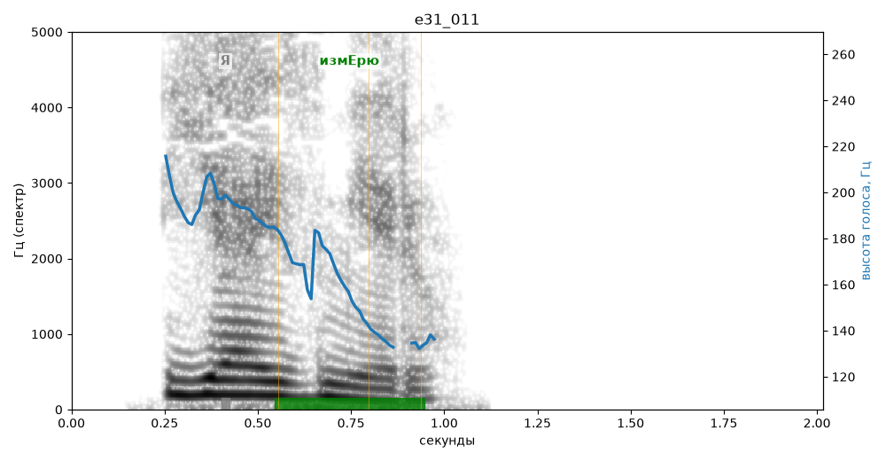

# e31_011

Голос: **edge:ru-RU-SvetlanaNeural** · длительность 2.0 с
Естественность (UTMOS): **4.09 из 5** (живой диктор ≈ 4–4.5)
Эталон: Я измерю!
Распознано: Я измерю.
Слова: все совпали

## Ударения
(где нужно: ruaccent)

| слово | нужно | у голоса | |
|---|---|---|---|
| измерю | измЕрю | измЕрю | ✓ |

## Интонация
- ✗ «я измерю!» — восклицание звучит ровно, без эмоции
- Диапазон голоса 7.4 полутонов (живо), средняя высота 178 Гц

## Паузы и темп
- паузы на своих местах
- Темп 5.5 слога/с (нормально)

_Синяя линия — высота голоса. Над словами заглавная буква — где ударение должно быть; красным — голос поставил не туда (уверенно), оранжевым — возможно._
