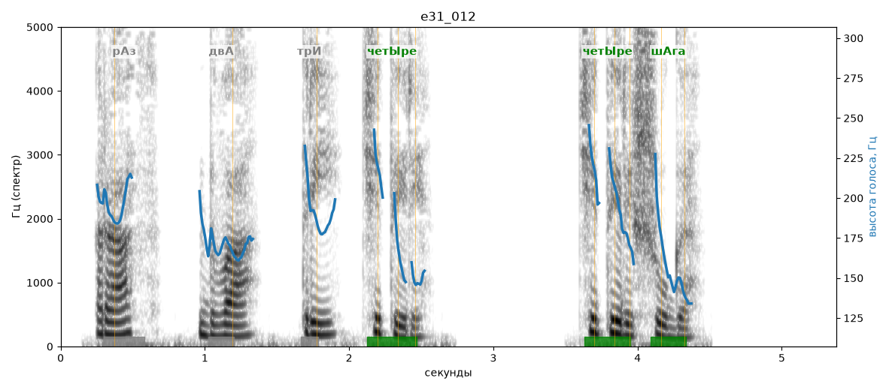

# e31_012

Голос: **edge:ru-RU-SvetlanaNeural** · длительность 5.4 с
Естественность (UTMOS): **3.83 из 5** (живой диктор ≈ 4–4.5)
Эталон: Раз, два, три, четыре! Четыре шага!
Распознано: 1, 2, 3, 4. 4 шуга.
Расхождения в словах: «раз два три четыре четыре шага» → «1 2 3 4 4 шуга»

## Ударения
(где нужно: ruaccent)

| слово | нужно | у голоса | |
|---|---|---|---|
| четыре | четЫре | четЫре | ✓ |
| четыре | четЫре | четЫре | ✓ |
| шага | шАга | шАга | ✓ |

## Интонация
- ✗ «раз два три четыре!» — восклицание звучит ровно, без эмоции
- ✓ «четыре шага!» — выделено слово «четыре» (+2.9 пт)
- Диапазон голоса 7.5 полутонов (живо), средняя высота 178 Гц

## Паузы и темп
- паузы на своих местах
- Темп 6.8 слога/с (быстро)

_Синяя линия — высота голоса. Над словами заглавная буква — где ударение должно быть; красным — голос поставил не туда (уверенно), оранжевым — возможно._
