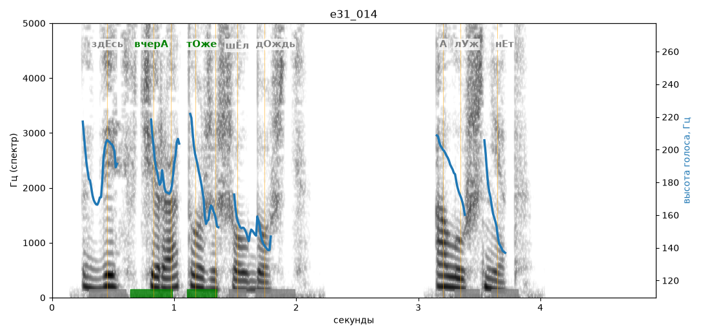

# e31_014

Голос: **edge:ru-RU-SvetlanaNeural** · длительность 4.9 с
Естественность (UTMOS): **3.77 из 5** (живой диктор ≈ 4–4.5)
Эталон: Здесь вчера тоже шёл дождь. А луж нет.
Распознано: Здесь вчера тоже шел дождь. А луж нет.
Слова: все совпали

## Ударения
(где нужно: ruaccent)

| слово | нужно | у голоса | |
|---|---|---|---|
| вчера | вчерА | вчерА | ✓ |
| тоже | тОже | тОже | ✓ |

## Интонация
- ✓ «здесь вчера тоже шёл дождь.» — конец фразы понижается — звучит законченно
- ✓ «а луж нет.» — конец фразы понижается — звучит законченно
- Диапазон голоса 6.8 полутонов (нормально), средняя высота 174 Гц

## Паузы и темп
- паузы на своих местах
- Темп 4.3 слога/с (нормально)

_Синяя линия — высота голоса. Над словами заглавная буква — где ударение должно быть; красным — голос поставил не туда (уверенно), оранжевым — возможно._
