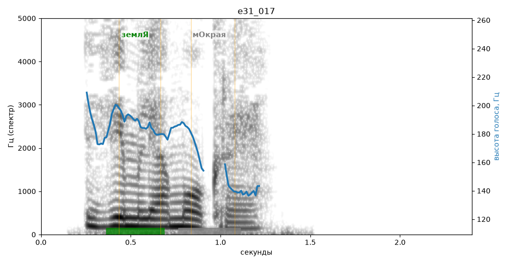

# e31_017

Голос: **edge:ru-RU-SvetlanaNeural** · длительность 2.4 с
Естественность (UTMOS): **4.0 из 5** (живой диктор ≈ 4–4.5)
Эталон: Земля мокрая!
Распознано: Земля мокрая.
Слова: все совпали

## Ударения
(где нужно: ruaccent)

| слово | нужно | у голоса | |
|---|---|---|---|
| земля | землЯ | землЯ | ✓ |
| мокрая | мОкрая | — | ? |

## Интонация
- ✗ «земля мокрая!» — восклицание звучит ровно, без эмоции
- Диапазон голоса 6.2 полутонов (нормально), средняя высота 181 Гц

## Паузы и темп
- паузы на своих местах
- Темп 5.4 слога/с (нормально)

_Синяя линия — высота голоса. Над словами заглавная буква — где ударение должно быть; красным — голос поставил не туда (уверенно), оранжевым — возможно._
