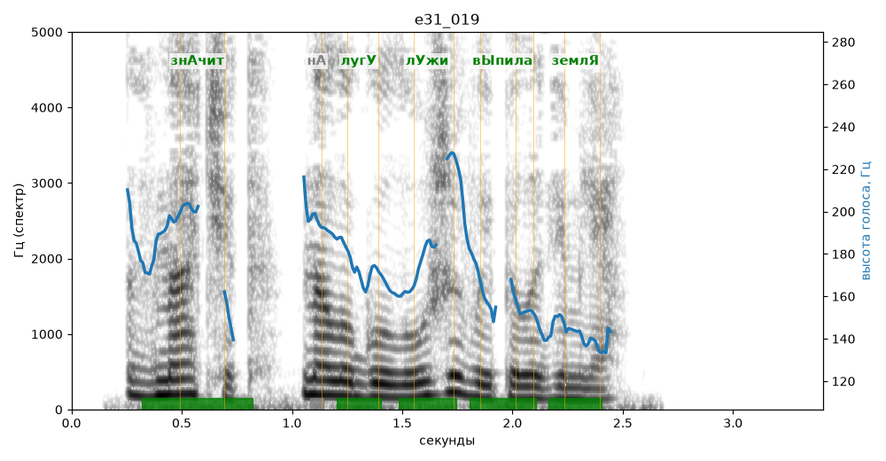

# e31_019

Голос: **edge:ru-RU-SvetlanaNeural** · длительность 3.4 с
Естественность (UTMOS): **4.0 из 5** (живой диктор ≈ 4–4.5)
Эталон: Значит, на лугу лужи выпила земля!
Распознано: Значит, на лугу лужи выпила земля.
Слова: все совпали

## Ударения
(где нужно: ruaccent)

| слово | нужно | у голоса | |
|---|---|---|---|
| значит | знАчит | знАчит | ✓ |
| лугу | лугУ | лугУ | ✓ |
| лужи | лУжи | лУжи | ✓ |
| выпила | вЫпила | вЫпила | ✓ |
| земля | землЯ | землЯ | ✓ |

## Интонация
- ✓ «значит на лугу лужи выпила земля!» — выделено слово «значит» (+3.4 пт)
- Диапазон голоса 7.0 полутонов (живо), средняя высота 171 Гц

## Паузы и темп
- паузы на своих местах
- Темп 6.6 слога/с (быстро)

_Синяя линия — высота голоса. Над словами заглавная буква — где ударение должно быть; красным — голос поставил не туда (уверенно), оранжевым — возможно._
