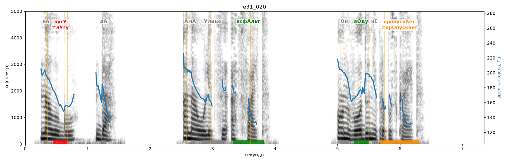

# e31_020

Голос: **edge:ru-RU-SvetlanaNeural** · длительность 7.3 с
Естественность (UTMOS): **3.89 из 5** (живой диктор ≈ 4–4.5)
Эталон: На лугу — да. А на улице асфальт. Он воду не пропускает.
Распознано: На лугу, да. А на улице асфальт. Он воду не пропускает.
Слова: все совпали

## Ударения
(где нужно: ruaccent)

| слово | нужно | у голоса | |
|---|---|---|---|
| лугу | лугУ | лУгу | ✗ ОШИБКА |
| улице | Улице | улицЕ | ? не разобрать |
| асфальт | асфАльт | асфАльт | ✓ |
| воду | вОду | вОду | ✓ |
| пропускает | пропускАет | прОпускает | ✗? возможно — послушать |

## Интонация
- ✗ «на лугу да.» — конец фразы не понижается — звучит незаконченно / как перечисление
- ✓ «а на улице асфальт.» — конец фразы понижается — звучит законченно
- ✓ «он воду не пропускает.» — конец фразы понижается — звучит законченно
- Диапазон голоса 7.4 полутонов (живо), средняя высота 171 Гц

## Паузы и темп
- паузы на своих местах
- Темп 6.8 слога/с (быстро)

_Синяя линия — высота голоса. Над словами заглавная буква — где ударение должно быть; красным — голос поставил не туда (уверенно), оранжевым — возможно._
