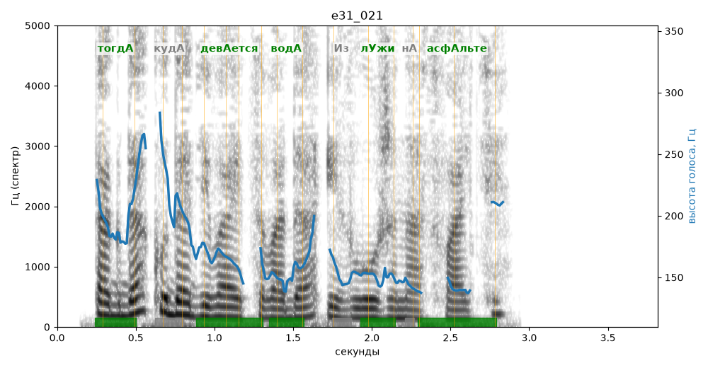

# e31_021

Голос: **edge:ru-RU-SvetlanaNeural** · длительность 3.8 с
Естественность (UTMOS): **4.05 из 5** (живой диктор ≈ 4–4.5)
Эталон: Тогда куда девается вода из лужи на асфальте?
Распознано: Тогда куда девается вода из лужи на асфальте?
Слова: все совпали

## Ударения
(где нужно: ruaccent)

| слово | нужно | у голоса | |
|---|---|---|---|
| тогда | тогдА | тогдА | ✓ |
| куда | кудА | кУда | ? не разобрать |
| девается | девАется | девАется | ✓ |
| вода | водА | водА | ✓ |
| лужи | лУжи | лУжи | ✓ |
| асфальте | асфАльте | асфАльте | ✓ |

## Интонация
- ✗ «тогда куда девается вода из лужи на асфальте?» — нет вопросительного подъёма (самое высокое место — «тогда», в начале) — звучит как утверждение
- Диапазон голоса 9.2 полутонов (живо), средняя высота 161 Гц

## Паузы и темп
- паузы на своих местах
- Темп 7.2 слога/с (быстро)

_Синяя линия — высота голоса. Над словами заглавная буква — где ударение должно быть; красным — голос поставил не туда (уверенно), оранжевым — возможно._
