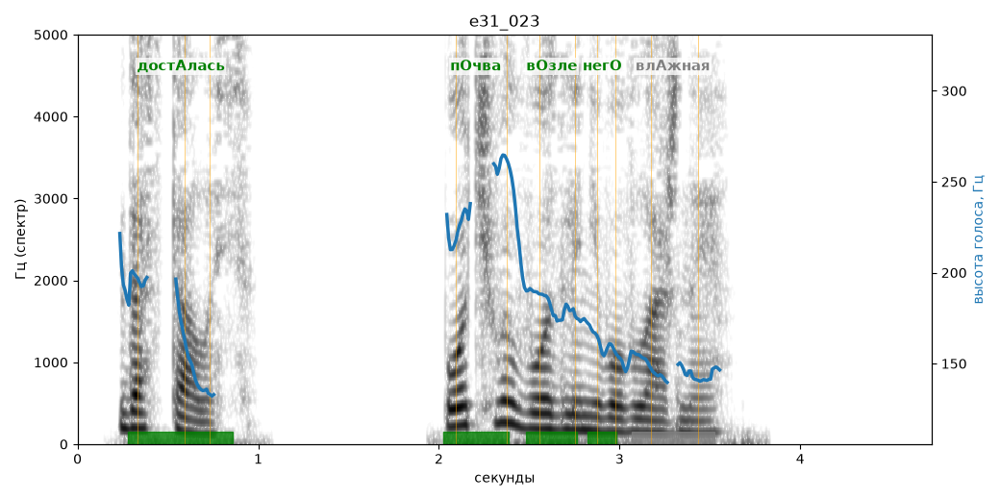

# e31_023

Голос: **edge:ru-RU-SvetlanaNeural** · длительность 4.7 с
Естественность (UTMOS): **4.03 из 5** (живой диктор ≈ 4–4.5)
Эталон: Досталась. Почва возле него влажная.
Распознано: Досталось. Почва возле него влажная.
Расхождения в словах: «досталась» → «досталось»

## Ударения
(где нужно: ruaccent)

| слово | нужно | у голоса | |
|---|---|---|---|
| досталась | достАлась | достАлась | ✓ |
| почва | пОчва | пОчва | ✓ |
| возле | вОзле | вОзле | ✓ |
| него | негО | негО | ✓ |
| влажная | влАжная | — | ? |

## Интонация
- ✗ «досталась.» — конец фразы не понижается — звучит незаконченно / как перечисление
- ✓ «почва возле него влажная.» — конец фразы понижается — звучит законченно
- Диапазон голоса 10.7 полутонов (живо), средняя высота 172 Гц

## Паузы и темп
- паузы на своих местах
- Темп 5.3 слога/с (нормально)

_Синяя линия — высота голоса. Над словами заглавная буква — где ударение должно быть; красным — голос поставил не туда (уверенно), оранжевым — возможно._
