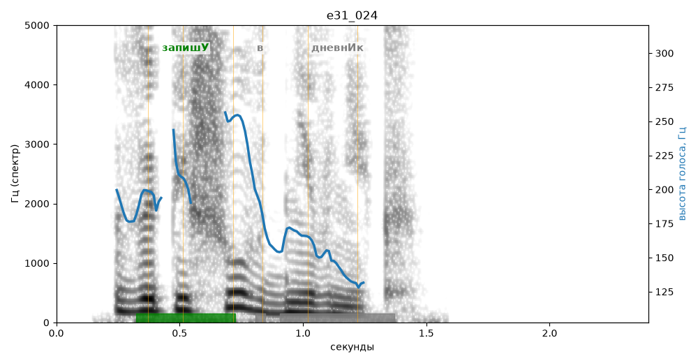

# e31_024

Голос: **edge:ru-RU-SvetlanaNeural** · длительность 2.4 с
Естественность (UTMOS): **4.01 из 5** (живой диктор ≈ 4–4.5)
Эталон: Запишу в дневник.
Распознано: Запишу в дневник.
Слова: все совпали

## Ударения
(где нужно: ruaccent)

| слово | нужно | у голоса | |
|---|---|---|---|
| запишу | запишУ | запишУ | ✓ |
| дневник | дневнИк | днЕвник | ? не разобрать |

## Интонация
- ✓ «запишу в дневник.» — конец фразы понижается — звучит законченно
- Диапазон голоса 11.2 полутонов (живо), средняя высота 176 Гц

## Паузы и темп
- паузы на своих местах
- Темп 5.7 слога/с (нормально)

_Синяя линия — высота голоса. Над словами заглавная буква — где ударение должно быть; красным — голос поставил не туда (уверенно), оранжевым — возможно._
