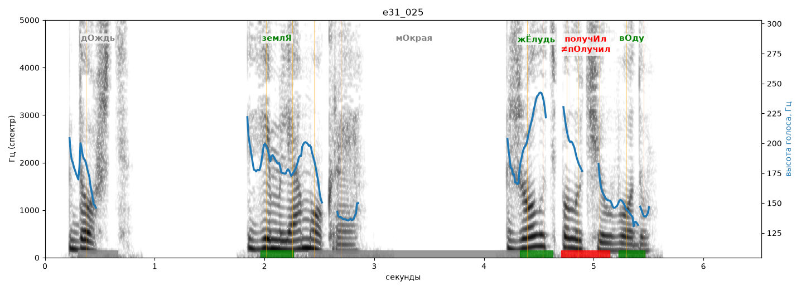

# e31_025

Голос: **edge:ru-RU-SvetlanaNeural** · длительность 6.5 с
Естественность (UTMOS): **3.99 из 5** (живой диктор ≈ 4–4.5)
Эталон: Дождь. Земля мокрая. Жёлудь получил воду
Распознано: Дождь. Земля мокрая. Желать получил воду.
Расхождения в словах: «желудь» → «желать»

## Ударения
(где нужно: ruaccent)

| слово | нужно | у голоса | |
|---|---|---|---|
| земля | землЯ | землЯ | ✓ |
| мокрая | мОкрая | — | ? |
| жёлудь | жЁлудь | жЁлудь | ✓ |
| получил | получИл | пОлучил | ✗ ОШИБКА |
| воду | вОду | вОду | ✓ |

## Интонация
- ✗ «земля мокрая.» — конец фразы не понижается — звучит незаконченно / как перечисление
- ✓ «жёлудь получил воду» — конец фразы понижается — звучит законченно
- Диапазон голоса 8.9 полутонов (живо), средняя высота 178 Гц

## Паузы и темп
- после «мокрая.» пауза всего 0.00 с — фразы слипаются
- Темп 3.1 слога/с (медленно)

_Синяя линия — высота голоса. Над словами заглавная буква — где ударение должно быть; красным — голос поставил не туда (уверенно), оранжевым — возможно._
