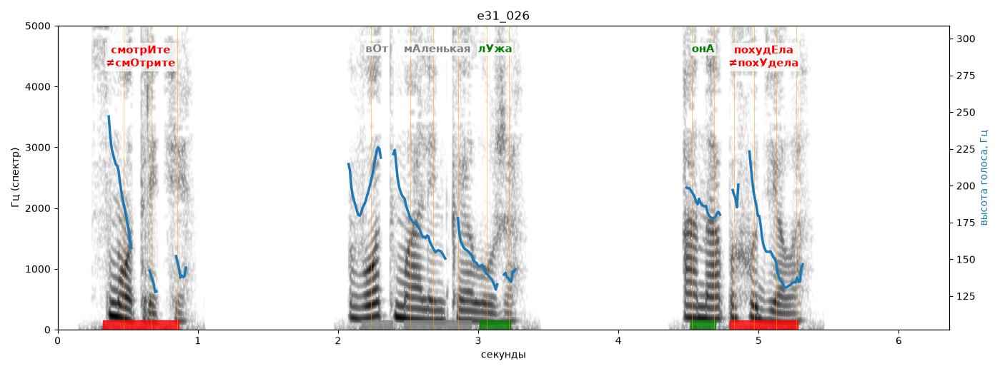

# e31_026

Голос: **edge:ru-RU-SvetlanaNeural** · длительность 6.4 с
Естественность (UTMOS): **3.98 из 5** (живой диктор ≈ 4–4.5)
Эталон: Смотрите! Вот маленькая лужа! Она похудела!
Распознано: Смотрите. Вот маленькая лужа. Она похудела.
Слова: все совпали

## Ударения
(где нужно: ruaccent)

| слово | нужно | у голоса | |
|---|---|---|---|
| смотрите | смотрИте | смОтрите | ✗ ОШИБКА |
| маленькая | мАленькая | — | ? |
| лужа | лУжа | лУжа | ✓ |
| она | онА | онА | ✓ |
| похудела | похудЕла | похУдела | ✗ ОШИБКА |

## Интонация
- ✗ «смотрите!» — восклицание звучит ровно, без эмоции
- ✓ «вот маленькая лужа!» — выделено слово «вот» (+3.8 пт)
- ✗ «она похудела!» — восклицание звучит ровно, без эмоции
- Диапазон голоса 8.7 полутонов (живо), средняя высота 168 Гц

## Паузы и темп
- паузы на своих местах
- Темп 6.3 слога/с (нормально)

_Синяя линия — высота голоса. Над словами заглавная буква — где ударение должно быть; красным — голос поставил не туда (уверенно), оранжевым — возможно._
