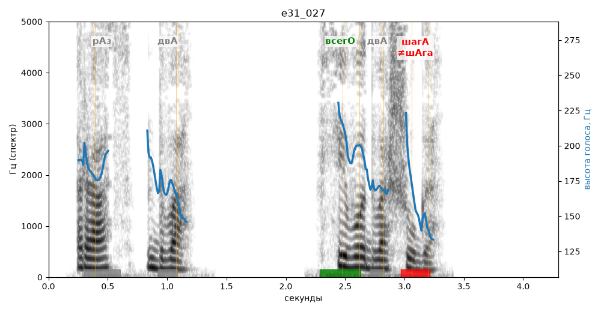

# e31_027

Голос: **edge:ru-RU-SvetlanaNeural** · длительность 4.3 с
Естественность (UTMOS): **3.51 из 5** (живой диктор ≈ 4–4.5)
Эталон: Раз, два! Всего два шага!
Распознано: Раз, два. Всего два шуга.
Расхождения в словах: «шага» → «шуга»

## Ударения
(где нужно: ruaccent)

| слово | нужно | у голоса | |
|---|---|---|---|
| всего | всегО | всегО | ✓ |
| шага | шагА | шАга | ✗ ОШИБКА |

## Интонация
- ✓ «всего два шага!» — выделено слово «всего» (+2.3 пт)
- Диапазон голоса 6.8 полутонов (нормально), средняя высота 176 Гц

## Паузы и темп
- паузы на своих местах
- Темп 5.1 слога/с (нормально)

_Синяя линия — высота голоса. Над словами заглавная буква — где ударение должно быть; красным — голос поставил не туда (уверенно), оранжевым — возможно._
