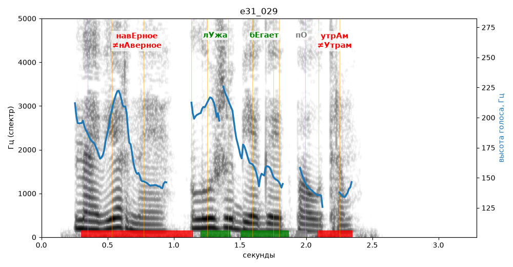

# e31_029

Голос: **edge:ru-RU-SvetlanaNeural** · длительность 3.3 с
Естественность (UTMOS): **3.71 из 5** (живой диктор ≈ 4–4.5)
Эталон: Наверное, лужа бегает по утрам.
Распознано: Наверное, лужи бегают по утрам.
Расхождения в словах: «лужа бегает» → «лужи бегают»

## Ударения
(где нужно: ruaccent)

| слово | нужно | у голоса | |
|---|---|---|---|
| наверное | навЕрное | нАверное | ✗ ОШИБКА |
| лужа | лУжа | лУжа | ✓ |
| бегает | бЕгает | бЕгает | ✓ |
| утрам | утрАм | Утрам | ✗ ОШИБКА |

## Интонация
- ✓ «наверное лужа бегает по утрам.» — конец фразы понижается — звучит законченно
- Диапазон голоса 8.1 полутонов (живо), средняя высота 166 Гц

## Паузы и темп
- паузы на своих местах
- Темп 5.9 слога/с (нормально)

_Синяя линия — высота голоса. Над словами заглавная буква — где ударение должно быть; красным — голос поставил не туда (уверенно), оранжевым — возможно._
