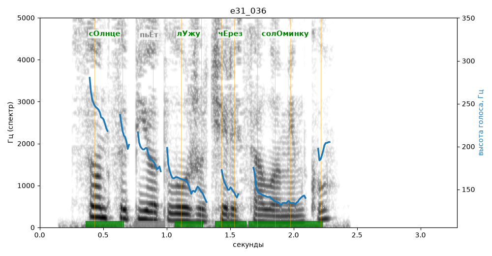

# e31_036

Голос: **edge:ru-RU-SvetlanaNeural** · длительность 3.3 с
Естественность (UTMOS): **3.98 из 5** (живой диктор ≈ 4–4.5)
Эталон: Солнце пьёт лужу через соломинку?
Распознано: Солнце пьет лужу через соломинку.
Слова: все совпали

## Ударения
(где нужно: ruaccent)

| слово | нужно | у голоса | |
|---|---|---|---|
| солнце | сОлнце | сОлнце | ✓ |
| лужу | лУжу | лУжу | ✓ |
| через | чЕрез | чЕрез | ✓ |
| соломинку | солОминку | солОминку | ✓ |

## Интонация
- ✗ «солнце пьёт лужу через соломинку?» — нет вопросительного подъёма (самое высокое место — «солнце», в начале) — звучит как утверждение
- Диапазон голоса 10.3 полутонов (живо), средняя высота 161 Гц

## Паузы и темп
- паузы на своих местах
- Темп 5.9 слога/с (нормально)

_Синяя линия — высота голоса. Над словами заглавная буква — где ударение должно быть; красным — голос поставил не туда (уверенно), оранжевым — возможно._
