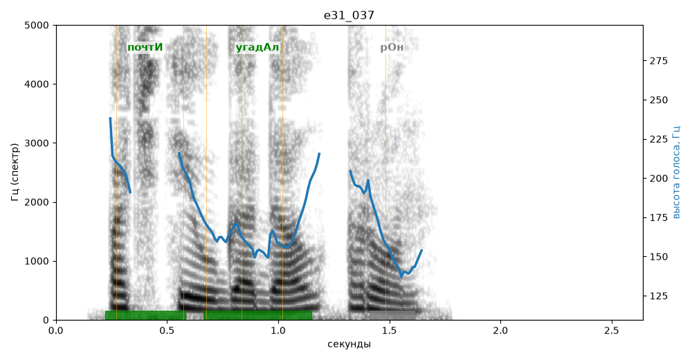

# e31_037

Голос: **edge:ru-RU-SvetlanaNeural** · длительность 2.6 с
Естественность (UTMOS): **4.03 из 5** (живой диктор ≈ 4–4.5)
Эталон: Почти угадал, Рон.
Распознано: Почти угадал, Рон.
Слова: все совпали

## Ударения
(где нужно: ruaccent)

| слово | нужно | у голоса | |
|---|---|---|---|
| почти | почтИ | почтИ | ✓ |
| угадал | угадАл | угадАл | ✓ |

## Интонация
- ✗ «почти угадал рон.» — конец фразы не понижается — звучит незаконченно / как перечисление
- Диапазон голоса 6.7 полутонов (нормально), средняя высота 167 Гц

## Паузы и темп
- паузы на своих местах
- Темп 5.3 слога/с (нормально)

_Синяя линия — высота голоса. Над словами заглавная буква — где ударение должно быть; красным — голос поставил не туда (уверенно), оранжевым — возможно._
