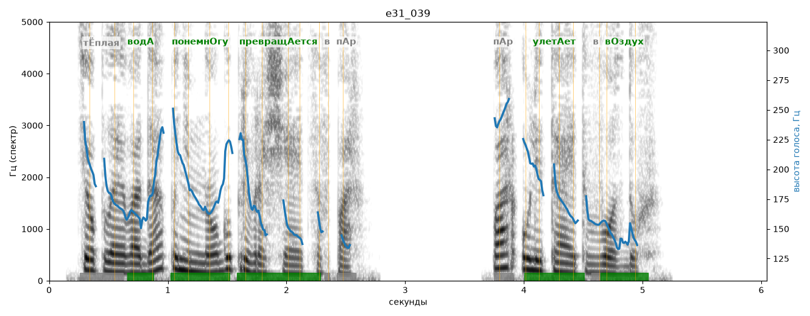

# e31_039

Голос: **edge:ru-RU-SvetlanaNeural** · длительность 6.0 с
Естественность (UTMOS): **3.86 из 5** (живой диктор ≈ 4–4.5)
Эталон: Тёплая вода понемногу превращается в пар. Пар улетает в воздух.
Распознано: Теплая вода понемногу превращается в пар. Пар улетает в воздух.
Слова: все совпали

## Ударения
(где нужно: ruaccent)

| слово | нужно | у голоса | |
|---|---|---|---|
| тёплая | тЁплая | — | ? |
| вода | водА | водА | ✓ |
| понемногу | понемнОгу | понемнОгу | ✓ |
| превращается | превращАется | превращАется | ✓ |
| улетает | улетАет | улетАет | ✓ |
| воздух | вОздух | вОздух | ✓ |

## Интонация
- ✓ «тёплая вода понемногу превращается в пар.» — конец фразы понижается — звучит законченно
- ✓ «пар улетает в воздух.» — конец фразы понижается — звучит законченно
- Диапазон голоса 9.4 полутонов (живо), средняя высота 169 Гц

## Паузы и темп
- паузы на своих местах
- Темп 6.3 слога/с (нормально)

_Синяя линия — высота голоса. Над словами заглавная буква — где ударение должно быть; красным — голос поставил не туда (уверенно), оранжевым — возможно._
