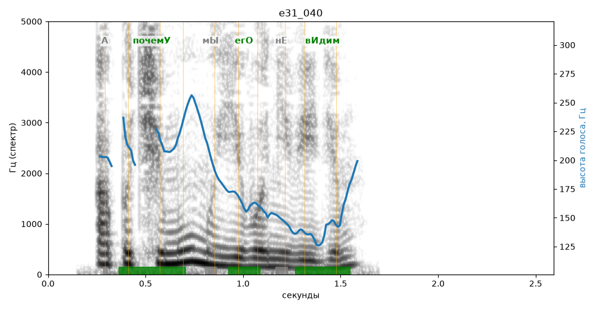

# e31_040

Голос: **edge:ru-RU-SvetlanaNeural** · длительность 2.6 с
Естественность (UTMOS): **4.05 из 5** (живой диктор ≈ 4–4.5)
Эталон: А почему мы его не видим?
Распознано: А почему мы его не видим?
Слова: все совпали

## Ударения
(где нужно: ruaccent)

| слово | нужно | у голоса | |
|---|---|---|---|
| почему | почемУ | почемУ | ✓ |
| его | егО | егО | ✓ |
| видим | вИдим | вИдим | ✓ |

## Интонация
- ✗ «а почему мы его не видим?» — нет вопросительного подъёма (самое высокое место — «почему», в начале) — звучит как утверждение
- Диапазон голоса 10.3 полутонов (живо), средняя высота 173 Гц

## Паузы и темп
- паузы на своих местах
- Темп 7.9 слога/с (быстро)

_Синяя линия — высота голоса. Над словами заглавная буква — где ударение должно быть; красным — голос поставил не туда (уверенно), оранжевым — возможно._
