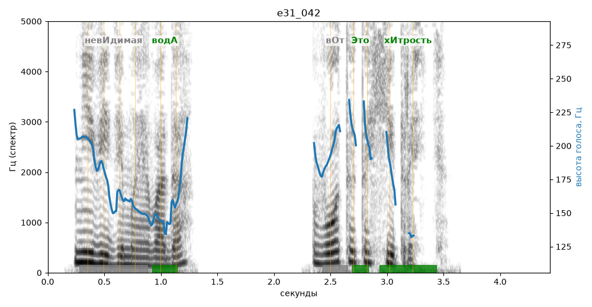

# e31_042

Голос: **edge:ru-RU-SvetlanaNeural** · длительность 4.4 с
Естественность (UTMOS): **3.74 из 5** (живой диктор ≈ 4–4.5)
Эталон: Невидимая вода? Вот это хитрость!
Распознано: Невидимая вода? Вот это хитрость.
Слова: все совпали

## Ударения
(где нужно: ruaccent)

| слово | нужно | у голоса | |
|---|---|---|---|
| невидимая | невИдимая | — | ? |
| вода | водА | водА | ✓ |
| это | Это | Это | ✓ |
| хитрость | хИтрость | хИтрость | ✓ |

## Интонация
- ✗ «невидимая вода?» — нет вопросительного подъёма (самое высокое место — «невидимая», в начале) — звучит как утверждение
- ✓ «вот это хитрость!» — выделено слово «это» (+2.0 пт)
- Диапазон голоса 7.3 полутонов (живо), средняя высота 177 Гц

## Паузы и темп
- паузы на своих местах
- Темп 5.9 слога/с (нормально)

_Синяя линия — высота голоса. Над словами заглавная буква — где ударение должно быть; красным — голос поставил не туда (уверенно), оранжевым — возможно._
