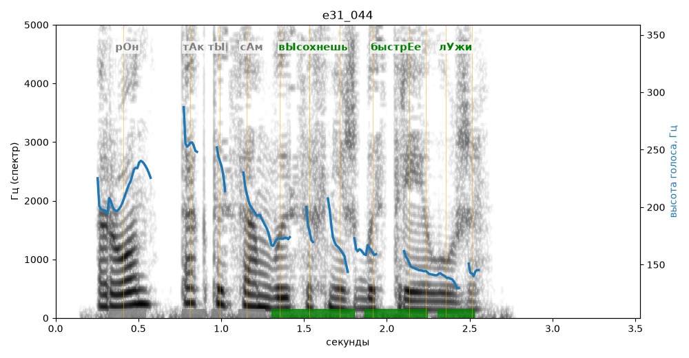

# e31_044

Голос: **edge:ru-RU-SvetlanaNeural** · длительность 3.5 с
Естественность (UTMOS): **3.74 из 5** (живой диктор ≈ 4–4.5)
Эталон: Рон, так ты сам высохнешь быстрее лужи!
Распознано: Рон, так ты сам высохнешь быстрее луже.
Расхождения в словах: «лужи» → «луже»

## Ударения
(где нужно: ruaccent)

| слово | нужно | у голоса | |
|---|---|---|---|
| высохнешь | вЫсохнешь | вЫсохнешь | ✓ |
| быстрее | быстрЕе | быстрЕе | ✓ |
| лужи | лУжи | лУжи | ✓ |

## Интонация
- ✓ «рон так ты сам высохнешь быстрее лужи!» — выделено слово «так» (+7.0 пт)
- Диапазон голоса 10.2 полутонов (живо), средняя высота 173 Гц

## Паузы и темп
- паузы на своих местах
- Темп 6.0 слога/с (нормально)

_Синяя линия — высота голоса. Над словами заглавная буква — где ударение должно быть; красным — голос поставил не туда (уверенно), оранжевым — возможно._
