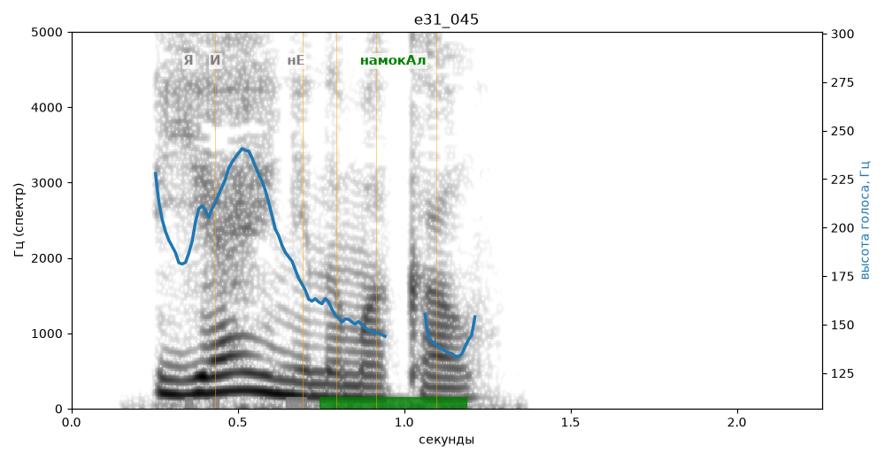

# e31_045

Голос: **edge:ru-RU-SvetlanaNeural** · длительность 2.3 с
Естественность (UTMOS): **4.13 из 5** (живой диктор ≈ 4–4.5)
Эталон: Я и не намокал.
Распознано: Я и не намокал.
Слова: все совпали

## Ударения
(где нужно: ruaccent)

| слово | нужно | у голоса | |
|---|---|---|---|
| намокал | намокАл | намокАл | ✓ |

## Интонация
- ✓ «я и не намокал.» — конец фразы понижается — звучит законченно
- Диапазон голоса 9.6 полутонов (живо), средняя высота 176 Гц

## Паузы и темп
- паузы на своих местах
- Темп 7.8 слога/с (быстро)

_Синяя линия — высота голоса. Над словами заглавная буква — где ударение должно быть; красным — голос поставил не туда (уверенно), оранжевым — возможно._
