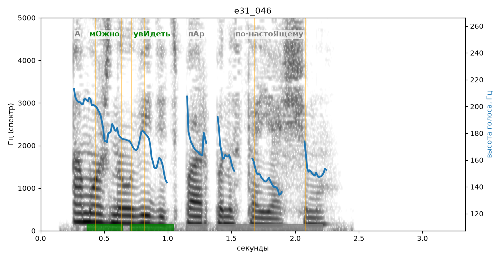

# e31_046

Голос: **edge:ru-RU-SvetlanaNeural** · длительность 3.3 с
Естественность (UTMOS): **3.77 из 5** (живой диктор ≈ 4–4.5)
Эталон: А можно увидеть пар по-настоящему?
Распознано: а можно увидеть пар по-настоящему.
Слова: все совпали

## Ударения
(где нужно: ruaccent)

| слово | нужно | у голоса | |
|---|---|---|---|
| можно | мОжно | мОжно | ✓ |
| увидеть | увИдеть | увИдеть | ✓ |
| по-настоящему | по-настоЯщему | — | ? |

## Интонация
- ✓ «а можно увидеть пар по-настоящему?» — вопросительный подъём на слове «а»
- Диапазон голоса 6.4 полутонов (нормально), средняя высота 168 Гц

## Паузы и темп
- паузы на своих местах
- Темп 6.2 слога/с (нормально)

_Синяя линия — высота голоса. Над словами заглавная буква — где ударение должно быть; красным — голос поставил не туда (уверенно), оранжевым — возможно._
