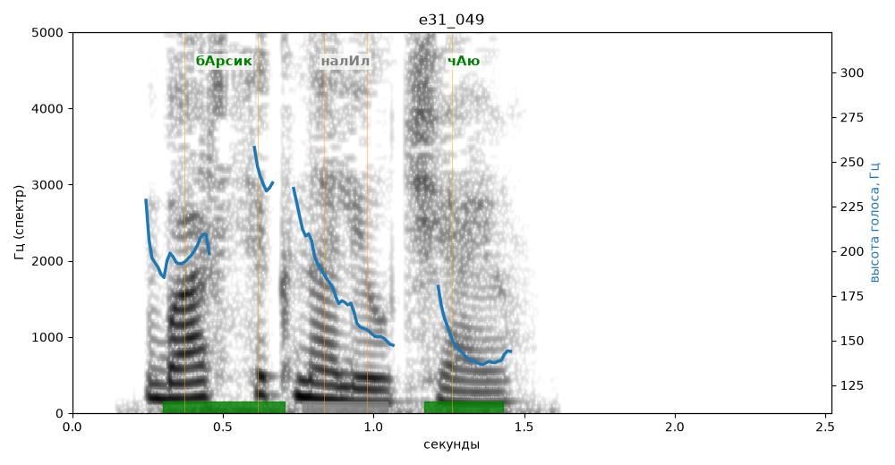

# e31_049

Голос: **edge:ru-RU-SvetlanaNeural** · длительность 2.5 с
Естественность (UTMOS): **4.32 из 5** (живой диктор ≈ 4–4.5)
Эталон: Барсик налил чаю.
Распознано: Барсик налил чаю.
Слова: все совпали

## Ударения
(где нужно: ruaccent)

| слово | нужно | у голоса | |
|---|---|---|---|
| барсик | бАрсик | бАрсик | ✓ |
| налил | налИл | нАлил | ? не разобрать |
| чаю | чАю | чАю | ✓ |

## Интонация
- ✓ «барсик налил чаю.» — конец фразы понижается — звучит законченно
- Диапазон голоса 9.4 полутонов (живо), средняя высота 177 Гц

## Паузы и темп
- паузы на своих местах
- Темп 4.4 слога/с (нормально)

_Синяя линия — высота голоса. Над словами заглавная буква — где ударение должно быть; красным — голос поставил не туда (уверенно), оранжевым — возможно._
